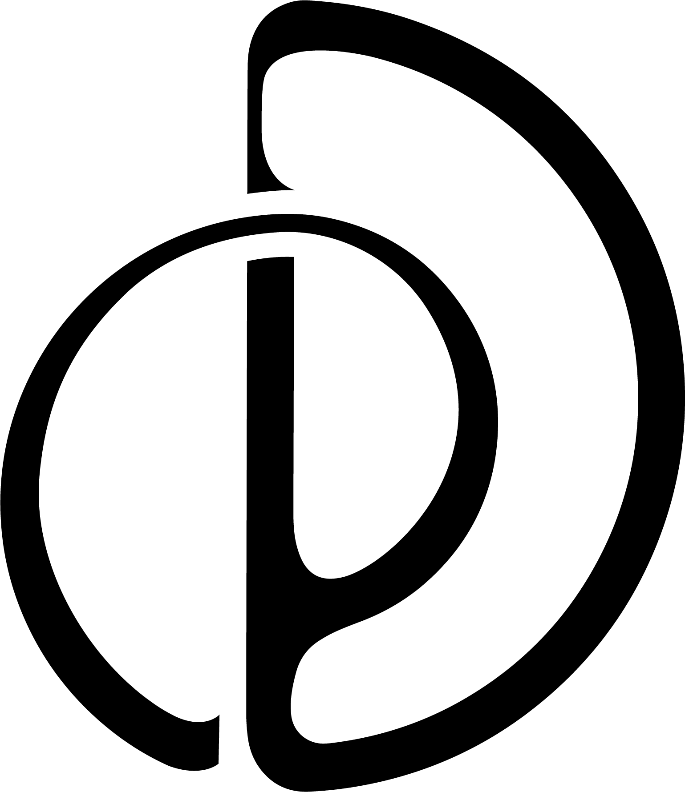

<p align="center">
  <a href="https://github.com/Physis-AI/PhysisServe">
    
  </a>
</p>

# PhysisServe

A lightweight inference engine for autoregressive video diffusion.

[Blog](https://physis-ai.com/blog/physisserve/en) · [Models](https://huggingface.co/collections/Physis-AI/physisserve-dev-model) · [Quick Start](#quick-start) · [Roadmap](#roadmap)

PhysisServe schedules work at the granularity of a Transformer block and a denoising step, overlapping chunks across GPUs. One Python API handles both single-stream and concurrent generation.

## Features

- **Stage-wise pipelining** across denoising steps and Transformer blocks.
- **VirtualRank scheduling** with stage-level time-sharing and same-block batching within each stream; **StageEqual** as a non-batched baseline.
- **Single-GPU, multi-GPU, and multi-node execution** with the same generation API.
- **Five model profiles**, reusing Diffusers components and loading standard Diffusers checkpoints from Hugging Face or local directories.

The model profiles use four denoising steps, same-step noisy KV history, and a clean-sink bootstrap (σ=0.001 for H3). Steady-state chunks contain one latent frame; the first chunk contains three for Wan/LTX and one for H3. FPS is fixed by the model profile.

## Installation

Use Python 3.10+ and a CUDA-enabled PyTorch installation. From the repository root:

```bash
pip install -e .
```

## Supported Models

The following model releases use Diffusers format and support same-step noisy-KV inference.

| Model | Hugging Face Repository |
| --- | --- |
| MiniMax H3 33B | [physisserve-minimaxh3_33b-same_step-ls-dev](https://huggingface.co/Physis-AI/physisserve-minimaxh3_33b-same_step-ls-dev) |
| LTX-2.5 22B | [physisserve-ltx2p5_22b-same_step-ls-dev](https://huggingface.co/Physis-AI/physisserve-ltx2p5_22b-same_step-ls-dev) |
| Wan2.2 5B | [physisserve-wan2p2_5b-same_step-ls-dev](https://huggingface.co/Physis-AI/physisserve-wan2p2_5b-same_step-ls-dev) |
| Wan2.1 14B | [physisserve-wan2p1_14b-same_step-sdv2](https://huggingface.co/Physis-AI/physisserve-wan2p1_14b-same_step-sdv2) |
| Wan2.1 1.3B | [physisserve-wan2p1_1p3b-same_step-sdv2](https://huggingface.co/Physis-AI/physisserve-wan2p1_1p3b-same_step-sdv2) |

- `sdv2`: weights from StreamDiffusionV2, converted to Diffusers format.
- `ls-dev`: weights trained and released by Physis-AI.

Use the model weights linked above rather than the original base-model weights. GPU memory usage depends on the model, resolution, and number of concurrent streams.

## Quick Start

```python
import imageio.v3 as iio
from physisserve import PhysisServe, SamplingParams


def main():
    model = PhysisServe(
        "Physis-AI/physisserve-wan2p1_1p3b-same_step-sdv2",
        pipeline_parallel_size=1,
    )
    sampling_params = SamplingParams(mode="offline_decode")
    prompts = [
        "A corgi running along the beach at sunset.",
        "A paper boat floating down a quiet forest stream.",
    ]
    outputs = model.generate(prompts, sampling_params)

    for index, output in enumerate(outputs):
        iio.imwrite(
            f"video-{index}.mp4", output["video"].numpy(), fps=output["fps"],
            codec="libx264", pixelformat="yuv420p", macro_block_size=None,
            output_params=["-movflags", "+faststart"],
        )


if __name__ == "__main__":
    main()
```

See [example.py](example.py). A single prompt string also works; a list creates concurrent streams. Pass one `SamplingParams` for all prompts or one per prompt. Increase `pipeline_parallel_size` to use more GPUs on one node.

`SamplingParams.mode` controls VAE decoding:

| Mode | Behavior |
| --- | --- |
| `dit_only` | Return latents without VAE decoding. |
| `offline_decode` (default) | Save all streams' latents to disk, then decode. Each call gets a separate directory under `./latents`, or the supplied `latent_dir`. |
| `online_decode` | Decode completed chunks during denoising. Currently supported by the Wan profiles only. |

`generate()` returns completed outputs in all modes; `online_decode` is not a streaming response API. Outputs include `latents` and `fps`, plus `video` for decoding modes and `latent_path` when saved.

## Multi-node Execution

Run on each node with its own `NODE_RANK` and the same rank-zero `MASTER_ADDR`:

```bash
torchrun --nnodes=2 --nproc-per-node=4 --node-rank="$NODE_RANK" \
  --master-addr="$MASTER_ADDR" --master-port=29500 \
  --module physisserve.launch example.py
```

Set `NODE_RANK` to `0` or `1`. All nodes need the package, script, and access to the checkpoint. Only rank zero runs the script and writes outputs. The launcher uses the full GPU pool without changing `example.py`.

## Benchmark

[bench.py](bench.py) automatically profiles block costs and candidate memory/compute demands, then compares StageEqual and VirtualRank capacity over long `dit_only` runs. Defaults are `--slo-ms 1600 --max-streams 64`; both can be overridden. Use `--streams N` for a fixed-count performance comparison instead:

```bash
python bench.py Physis-AI/physisserve-wan2p1_1p3b-same_step-sdv2 \
  --gpus 2

python bench.py Physis-AI/physisserve-wan2p1_1p3b-same_step-sdv2 \
  --gpus 2 --streams 2
```

Raw measurements and placement decisions are saved under `bench-results/`; use `--resume PATH` with the same arguments after interruption. SLO qualification includes bootstrap gaps; resource estimates alone never qualify a stream count. Search limits and unverified points are reported explicitly.

## Roadmap

- [ ] **Serving engine**

  - [ ] ACWM and WAM support with interactive streaming.
  - [ ] Dynamic request arrival, completion, and cancellation.
  - [ ] Cross-stream block-weight sharing with independent KV caches.

- [ ] **Scheduling algorithms**

  - [ ] Admission and placement with per-stream priorities and SLOs.
  - [ ] Cross-stream batching of compatible same-block tasks.
  - [ ] Specialized inference and scheduling for real-time, multi-turn online interaction.

- [ ] **Post-training**

  - [ ] Bidirectional-to-autoregressive post-training for same-step noisy-KV inference.

## Contributing

Issues and pull requests are welcome.

## Acknowledgments

We thank [nano-vLLM](https://github.com/GeeeekExplorer/nano-vllm), [StreamDiffusionV2](https://github.com/chenfengxu714/StreamDiffusionV2), and [WaveForcing](https://github.com/SJTU-DENG-Lab/WaveForcing) for their open-source code and inspiration.

## Upstream Contributions

We will progressively contribute PhysisServe's capabilities to [vLLM-Omni](https://github.com/vllm-project/vllm-omni). [PR #8282](https://github.com/vllm-project/vllm-omni/pull/8282), which adds chunk-based autoregressive denoising and noisy-KV support, has been merged as the first part of this effort.
